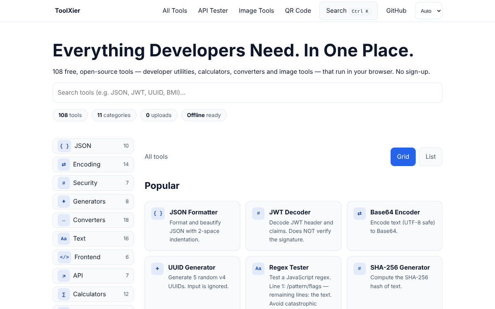
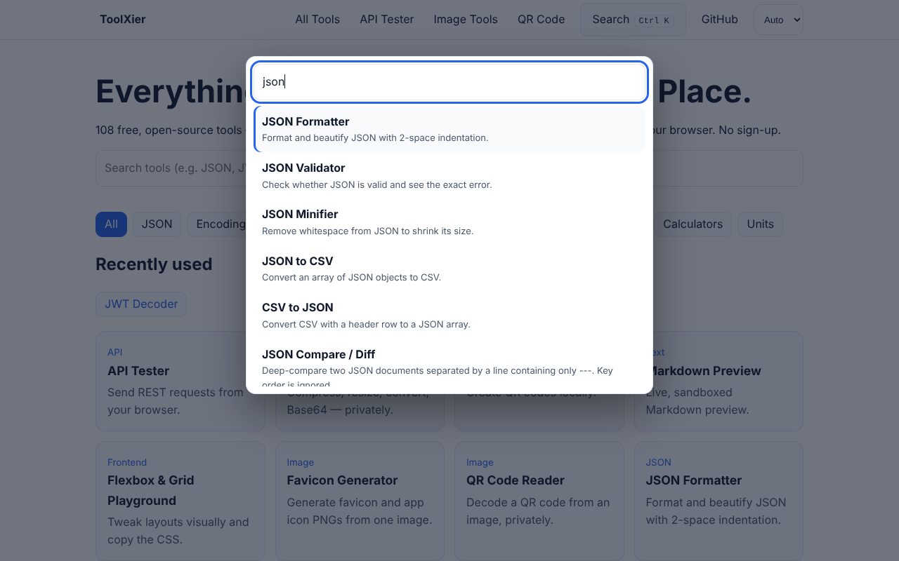
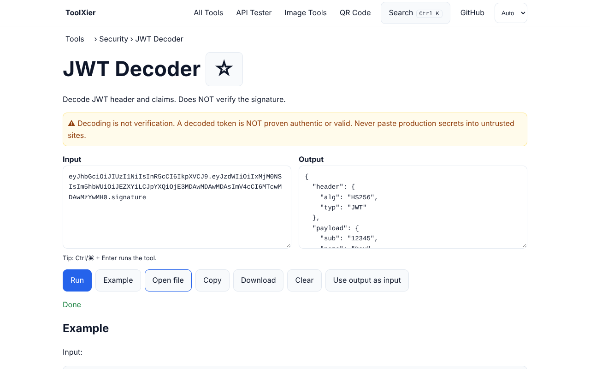
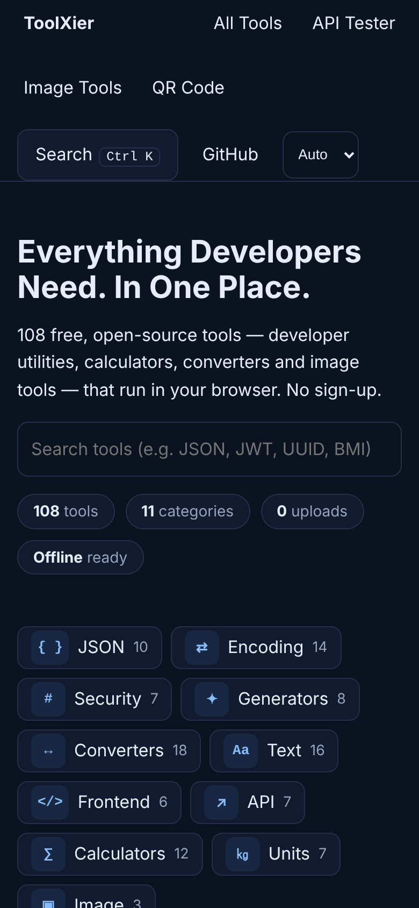
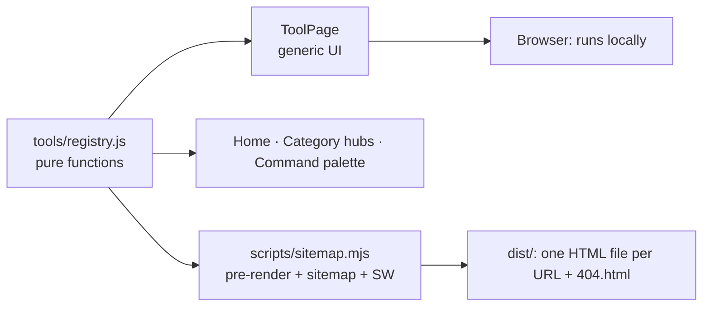

<div align="center">

# ToolXier

### Developer Tools. Simplified.

**101 free, privacy-first tools — plus an API tester, image tools and QR utilities — that run entirely in your browser.**
No sign-up. No uploads. Works offline. Open source.

[](https://github.com/alokxyadav/ToolXier/actions/workflows/ci.yml)


[Features](#-features) · [Publish](PUBLISHING.md) · [Quick start](#-quick-start) · [Add a tool](#-add-a-tool-in-5-minutes) · [Tool catalog](docs/TOOLS.md) · [Deploy](#-deploy) · [Contributing](#-contributing)



</div>

---

## ✨ Features

| | |
|---|---|
| ⚡ **Instant** | Tiny initial bundle (≈ 62 kB gzipped), route-level code splitting, tools run synchronously in your browser |
| 🔒 **Private by design** | Input never leaves your device. The only network tools (API Tester, DNS Lookup) say so on their page |
| ⌨️ **Keyboard first** | <kbd>Ctrl</kbd>/<kbd>⌘</kbd>+<kbd>K</kbd> command palette, <kbd>Ctrl</kbd>/<kbd>⌘</kbd>+<kbd>Enter</kbd> to run, full focus management |
| 📱 **Works everywhere** | Responsive from 320 px phones to desktop, touch-sized targets, light/dark/auto theme, safe-area aware |
| 📴 **Offline PWA** | Installable; the whole app is pre-cached, so even tools you never opened work offline |
| 🧭 **Dashboard home** | Every tool visible at once: sticky category sidebar with live section tracking, Popular / Favorites / Recently used, instant search, grid ↔ list view (remembered) |
| 🔎 **SEO-ready** | One pre-rendered URL per tool, unique titles/descriptions/canonicals, JSON-LD, 11 category hubs, crawlable links to every page even without JavaScript, sitemap, real 404s |
| ♿ **Accessible** | Labeled controls, live regions, visible focus, reduced-motion support |
| 🧪 **Heavily tested** | 199 automated tests + real-browser audit + Lighthouse scripts |

<table>
<tr>
<td></td>
<td></td>
<td width="180"></td>
</tr>
</table>

## 🧰 What's inside

**101 tools + 7 dedicated pages**, organised in 11 categories on a searchable dashboard — full list in the **[tool catalog](docs/TOOLS.md)** (auto-generated):

| Category | Highlights |
|---|---|
| **JSON** | Formatter, Validator, Minifier, Tree viewer, Diff, Key sorter, Escape/Unescape, JSON↔CSV |
| **Encoding** | Base64, URL, HTML entities, Unicode, Hex, Binary, ROT13, Morse, JWT decoder |
| **Security** | SHA-256/384/512, HMAC-SHA256, MD5 (with warning), Password strength |
| **Generators** | UUID, ULID, Passwords, Lorem Ipsum, Random numbers, Color palettes, UUID validator |
| **Converters** | JSON↔YAML, XML↔JSON, timestamps, time zones, number bases, chmod, cron, Roman numerals, number→words |
| **Text** | Regex tester, Text diff, Markdown→HTML, case/slug/title-case, sort, dedupe, strip HTML… |
| **Frontend** | CSS minify/beautify/gradient/box-shadow, HTML minifier |
| **API** | cURL→fetch/Axios, HTTP status codes, URL parser, CIDR calculator, DNS lookup |
| **Calculators** | BMI, GST/VAT, loan EMI, interest, percentage, discount, tip, statistics, GCD/LCM, primes |
| **Units** | Temperature, length, weight, speed, area, volume, duration |
| **Image** | Compress/resize/convert, favicon generator, QR code generator and reader |

**Dedicated pages:** API Tester · Image Tools (compress/resize/convert/Base64) · QR Code generator · QR Code reader · Markdown preview · Flexbox & Grid playground · Favicon generator.

## 🚀 Quick start

```bash
git clone https://github.com/alokxyadav/ToolXier.git
cd ToolXier
npm install
npm run dev        # http://localhost:5173
```
Requires **Node ≥ 20.19** (`nvm use` reads `.nvmrc`). More detail: **[SETUP.md](SETUP.md)**.

| Command | Purpose |
|---|---|
| `npm run dev` | Development server |
| `npm test` | Unit tests + simulated-browser tests for every page |
| `npm run build` | Production build + pre-rendered pages + sitemap + service worker |
| `npm run verify` | **One-command local check**: tests → build → serve → check all 125 pages, 404, PWA files |
| `npm run ship -- <repo-url>` | **One-command publish** to GitHub on a new branch (see [PUBLISHING.md](PUBLISHING.md)) |
| `npm run serve` | Serve `dist/` like a real host (real 404 status) |
| `npm run docs:tools` | Regenerate [docs/TOOLS.md](docs/TOOLS.md) |
| `cd audit && npm i && npm run audit` | Real-browser audit (124 URLs, mobile, offline, uploads) |
| `cd audit && npm run lighthouse` | Lighthouse scores |
| `npm run e2e` | Playwright specs (run `npx playwright install` first) |

## 🧩 Add a tool in 5 minutes

Every tool is one object in [`src/tools/registry.js`](src/tools/registry.js). The page, route, search, command palette, category hub, sitemap, pre-rendered HTML, structured data and "Example" section are **all generated from it**.

```js
{ slug: 'reverse-text', name: 'Reverse Text', category: 'Text',
  description: 'Reverse the characters in your text.',
  example: 'Hello',
  run: t => [...t].reverse().join('') }          // sync or async; throw Error('…') on bad input
```
Then add a test in `tests/tools.test.js`, run `npm test`, and open a PR. See [CONTRIBUTING.md](CONTRIBUTING.md).

## 🏗 Architecture


```
src/tools/registry.js   all tools (pure, tested)      src/pages/        route pages (lazy-loaded)
src/components/         palette, error boundary       src/hooks/        storage + SEO helpers
scripts/                sitemap/pre-render, server    audit/            real-browser + Lighthouse audits
public/                 manifest, icons, SW, _headers tests/            unit + render tests
```

## 🔐 Privacy & security
- Tools run **in your browser**; nothing is uploaded. Preferences (theme, favorites, recents) live in `localStorage`.
- **Network exceptions, clearly disclosed:** API Tester (requests go straight from your browser to the URL you enter, subject to CORS — no proxy) and DNS Lookup (domain sent to Cloudflare DNS-over-HTTPS).
- JWT decoder **does not verify signatures**; MD5 is flagged as insecure; the password checker is a local estimate.
- Markdown preview renders in a fully sandboxed frame; no `eval`, no HTML injection of user input; 2 MB input cap.
- One shared CSP and security-header set for Vercel, Cloudflare Pages and Netlify (guarded by a test). Report vulnerabilities per [SECURITY.md](SECURITY.md).

## ✅ Quality status (measured, not promised)
Last measured on the production build in headless Chromium: **199 tests passing · 0 failures across all 125 URLs on a 390 px phone viewport (console errors, overflow, labels, titles, canonicals, touch targets) · real 404 status · QR generate→read round-trip · offline load of a never-visited tool page · Lighthouse (mobile emulation) 100 / 100 / 100 / 100** (Performance / Accessibility / Best Practices / SEO), CLS 0.015. Lab scores vary by machine and host. Playwright specs are included but were not executed during authoring. Real-device (iOS Safari / Android Chrome) testing is recommended before launch.

## 🌐 Deploy
Build with your public URL (used for sitemap, canonicals, structured data):
```bash
SITE_URL=https://your-domain.com VITE_SITE_URL=https://your-domain.com npm run build
```
| Host | Settings |
|---|---|
| **Vercel** | Framework: Vite · env: `SITE_URL`, `VITE_SITE_URL` (`vercel.json` provides headers) |
| **Cloudflare Pages** | Build `npm run build` · output `dist` · same env (`public/_headers` provides headers) |
| **Netlify** | Build `npm run build` · publish `dist` |
> Do **not** add a catch-all SPA rewrite — pre-rendered pages and `404.html` give correct status codes.

## 🗺 Roadmap
Help wanted — see [open issues](https://github.com/alokxyadav/ToolXier/issues): JavaScript formatter/minifier (via a vetted lightweight library), privacy-reviewed IP lookup, per-tool FAQ content (from real user questions), more converters, i18n, Web Worker execution for very large inputs.

## 🤝 Contributing
Contributions of all sizes are welcome — new tools, bug fixes, translations, docs. Read **[CONTRIBUTING.md](CONTRIBUTING.md)** and the **[Code of Conduct](CODE_OF_CONDUCT.md)**; use the issue templates for bugs and tool requests. If ToolXier helps you, a ⭐ on GitHub helps others find it.

## 📄 License
[MIT](LICENSE) © ToolXier contributors. Dependencies keep their own licenses.

## 🙏 Acknowledgements
Built with [React](https://react.dev), [Vite](https://vite.dev), [React Router](https://reactrouter.com), [yaml](https://github.com/eemeli/yaml), [fast-xml-parser](https://github.com/NaturalIntelligence/fast-xml-parser), [qrcode](https://github.com/soldair/node-qrcode) and [jsQR](https://github.com/cozmo/jsQR). Inspired by the many great developer-tool sites that proved how useful this category is.
